<p align="center"><a href="https://jirkapelikan.cz"></a></p>

# OpenMathTutor

*Česká verze: [README.md](README.md)*

> Created and copyrighted by **[Jiří Pelikán](https://jirkapelikan.cz)**. A source-available project for **non-commercial** use ([PolyForm Noncommercial 1.0.0](LICENSE)); credit to the author must be kept when sharing or modifying it. Details in [Rights and license](#rights-and-license).

OpenMathTutor is an interactive whiteboard that reads your handwriting in real time and teaches you math, physics, and chemistry like a patient personal tutor.

---

## How it works in 60 seconds

1. **Pick a course:** choose preparation for high school entrance exams, graduation/maturita, university entrance, higher math, physics, chemistry, or upload your own notes.
2. **Write directly on the board:** with a stylus, finger on a touchscreen, mouse, or keyboard. No tool switching required.
3. **Instant local verification:** a lightweight neural model running directly in your browser reads handwriting in ~20 ms. The math verifier checks each step and shows a ✓ or ✗ badge on your machine without sending data to the cloud.
4. **The tutor reacts on the canvas:** when an error occurs, the animated mascot walks to the step and the AI tutor circles the mistake, draws an arrow, and writes hints or the next step in handwriting style right on the board.
5. **Ask anytime:** tap a quick reply button, talk via microphone, or type a chat message. The app tracks your progress and can generate a printable practice test with an answer key in PDF.

---

## Step-by-step tutorial

The following steps walk you through the entire application from initial launch to advanced tools.

### 1. Course selection and first lesson

When launched for the first time, an onboarding screen lets you pick your focus and level. Choosing a topic immediately opens a fresh digital whiteboard with your first problem. You can return to the course catalog anytime via the left drawer.

<video src="docs/media/01-first-lesson.mp4" controls muted width="720"></video>
<p><em>Recording: <a href="docs/media/01-first-lesson.mp4">docs/media/01-first-lesson.mp4</a> – Picking a course and opening the first lesson</em></p>

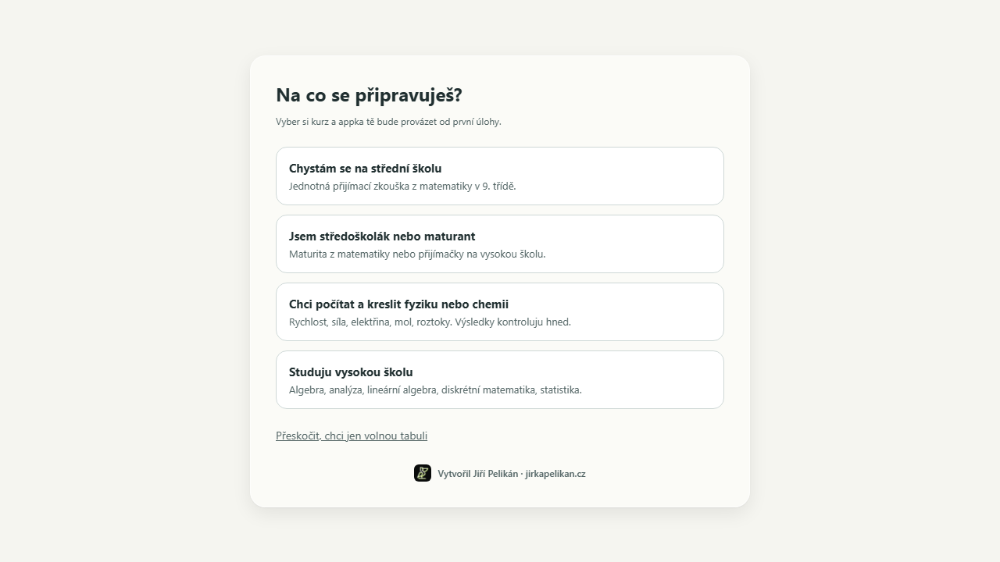
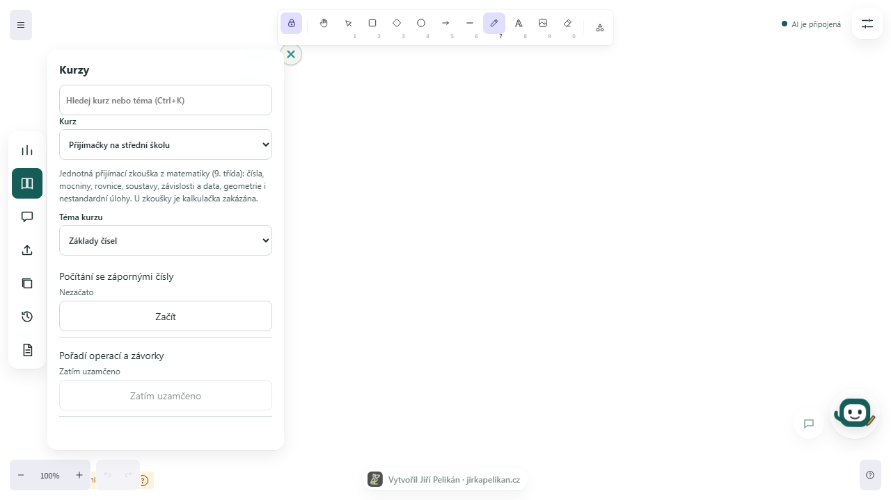
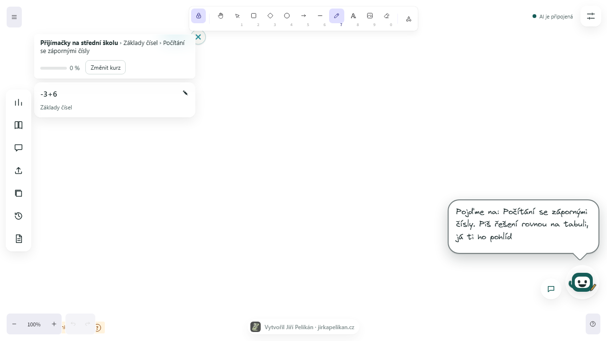


### 2. Handwriting and instant checking

Click anywhere on the board and write your solution. Pencil and pen strokes are automatically grouped into lines and mathematical symbols. Within ~20 ms after completing a line, a transcript and local verification verdict appear.

When a mistake is detected, the line is marked with a red ✗. The animated mascot walks over and offers guidance. If a digit was misread, tap the "Read as:" bubble and pick the correct candidate from the popover. The line recomputes in a single tap without needing a keyboard.

<video src="docs/media/02-handwriting-check.mp4" controls muted width="720"></video>
<p><em>Recording: <a href="docs/media/02-handwriting-check.mp4">docs/media/02-handwriting-check.mp4</a> – Handwriting, error detection, and one-tap correction</em></p>

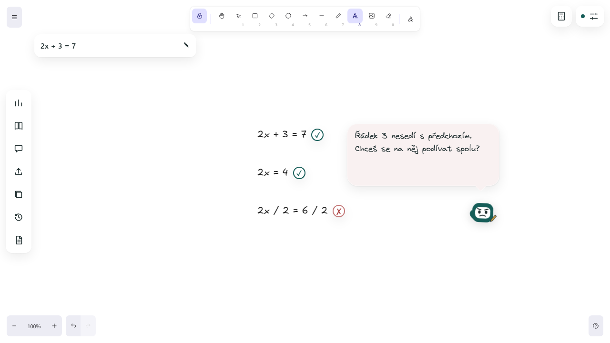
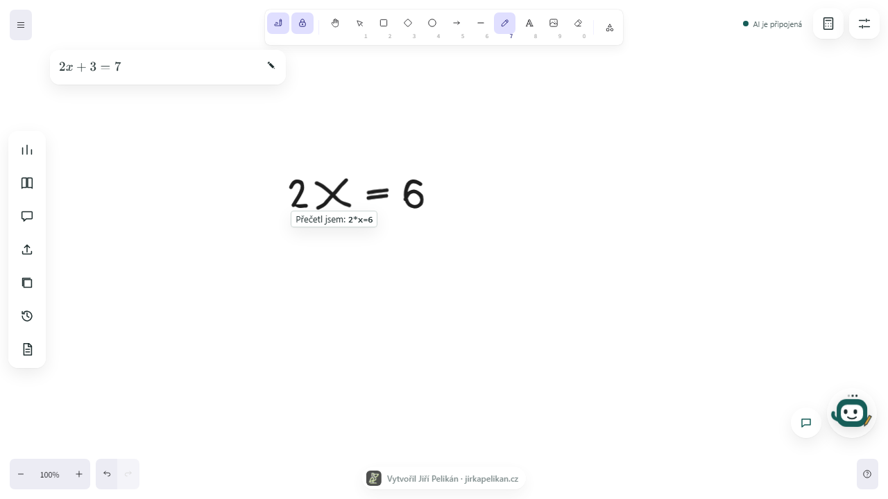

### 3. The AI teacher writes on the board

The AI tutor avoids walls of chat text. It writes like an in-person teacher on a dedicated board layer: circling or crossing out errors in red, drawing teal arrows, and writing handwritten explanations or worked steps. Teacher notes can be hidden or cleared at any time.

<video src="docs/media/03-ai-teacher-writes.mp4" controls muted width="720"></video>
<p><em>Recording: <a href="docs/media/03-ai-teacher-writes.mp4">docs/media/03-ai-teacher-writes.mp4</a> – Teacher annotations directly on the board</em></p>

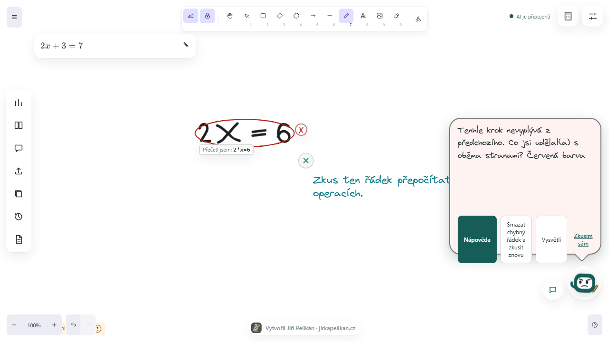

### 4. Conversation with the tutor

A button beside the mascot opens the tutor chat window. You can reply without typing using contextual quick-reply buttons ("Explain differently", "Show the next step", "Got it", "I do not get it", "Example"), talk using the microphone, or type a custom question. Basic app questions (what ✓/✗ means, how checking works, how to delete a line) are answered instantly on-device without calling AI.

<video src="docs/media/04-chat.mp4" controls muted width="720"></video>
<p><em>Recording: <a href="docs/media/04-chat.mp4">docs/media/04-chat.mp4</a> – Chat with tutor and quick replies</em></p>

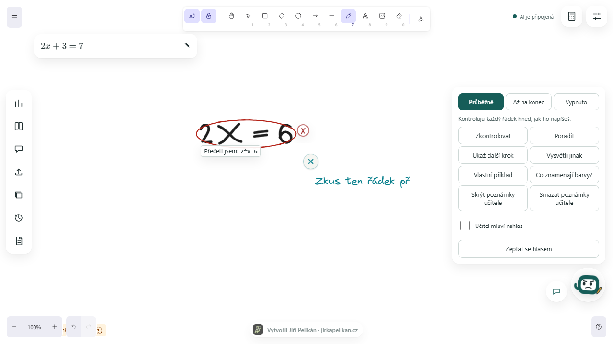
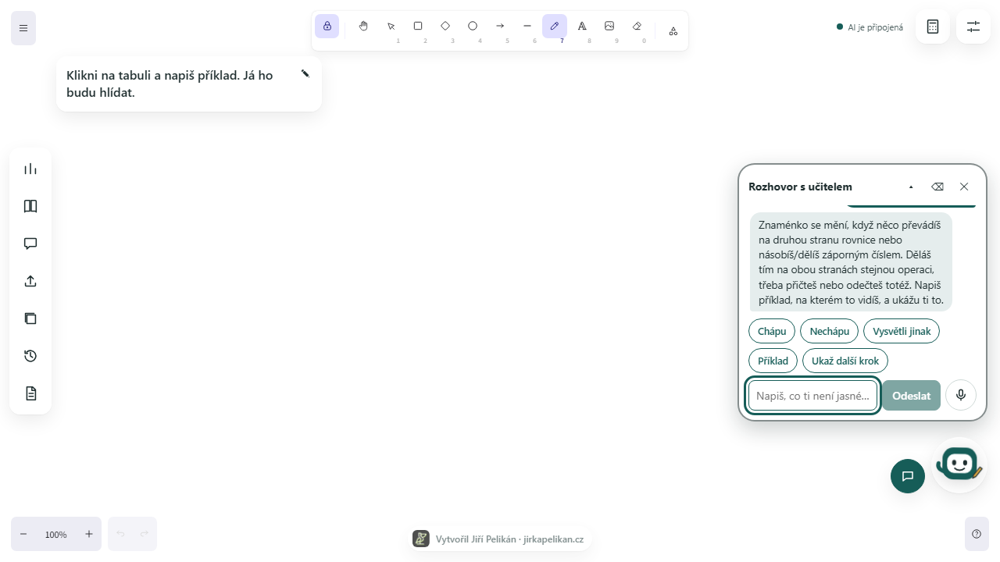

### 5. Plan and progress tracking

In the left drawer under "Plan and path", you can track mastered skills and overall course percentages. The adaptive engine suggests problems based on areas that need reinforcement. Only your first final attempt per problem counts toward mastery; subsequent corrections earn praise and advance you forward without inflating stats.

<video src="docs/media/05-plan-progress.mp4" controls muted width="720"></video>
<p><em>Recording: <a href="docs/media/05-plan-progress.mp4">docs/media/05-plan-progress.mp4</a> – Working through the plan and mastery percentages</em></p>

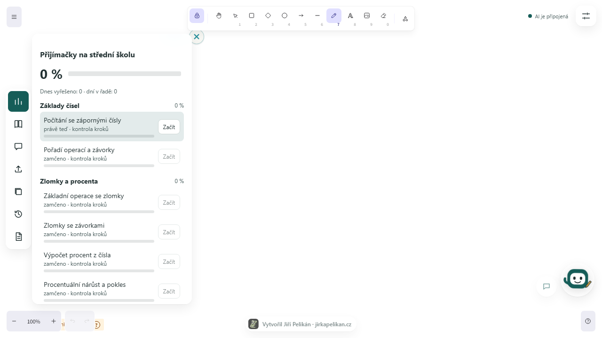


### 6. Physics, chemistry, and calculations with units

OpenMathTutor supports applied science beyond pure math. In physics and chemistry tracks, write quantities with their physical units (e.g. m/s, km/h, g/cm³, mol/l). The local verifier recognizes unit aliases, comma or dot decimals, and validates precision without loose percentage tolerances.

<video src="docs/media/06-physics-units.mp4" controls muted width="720"></video>
<p><em>Recording: <a href="docs/media/06-physics-units.mp4">docs/media/06-physics-units.mp4</a> – Solving physics problems with units</em></p>

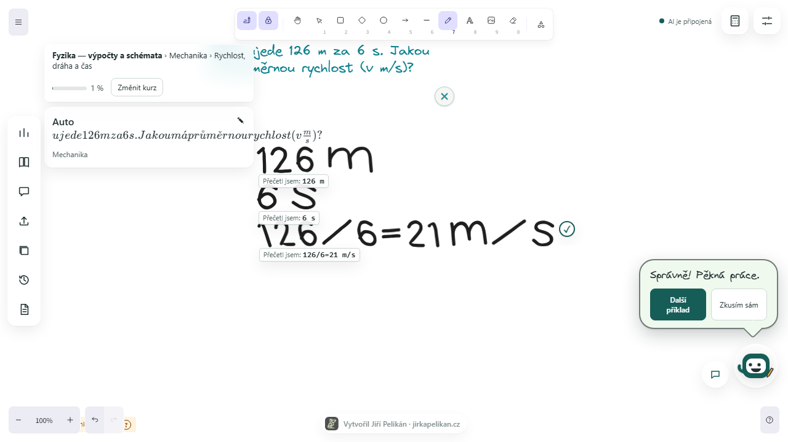


### 7. Take-home test and notes export

Want to practice on paper? Generate a printable test in HTML with a single click and save it as a PDF from your browser. The answer key and solutions are automatically placed on a separate final page. Board notes can be exported to Markdown (`.md`), and the whiteboard image can be saved as PNG or SVG.

<video src="docs/media/07-test-and-export.mp4" controls muted width="720"></video>
<p><em>Recording: <a href="docs/media/07-test-and-export.mp4">docs/media/07-test-and-export.mp4</a> – Generating a test and exporting notes</em></p>

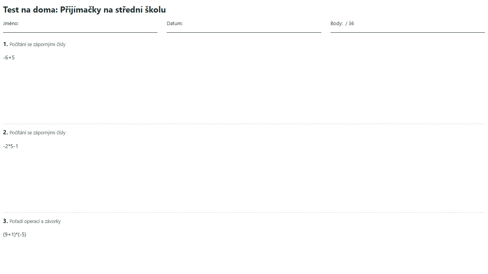

### 8. Settings, board paper patterns, and offline voices

The Settings drawer lets you tailor the workspace:
- **Paper patterns:** plain white, grid/graph paper, lined paper, dot grid, and school ruled paper with a margin line. The pattern scales smoothly with canvas pan and zoom.
- **Theme:** full dark and light mode for day or night studying.
- **Voice synthesis:** choose browser system voices or high-quality offline Piper neural voices (`cs_CZ-jirka`, English models) running in the browser via WebAssembly. The model is downloaded once (~60 MB) into browser storage and operates fully offline. Lessac research license terms are detailed in [NOTICE.md](NOTICE.md).

<video src="docs/media/08-settings-paper-voices.mp4" controls muted width="720"></video>
<p><em>Recording: <a href="docs/media/08-settings-paper-voices.mp4">docs/media/08-settings-paper-voices.mp4</a> – Switching paper patterns and selecting voices</em></p>

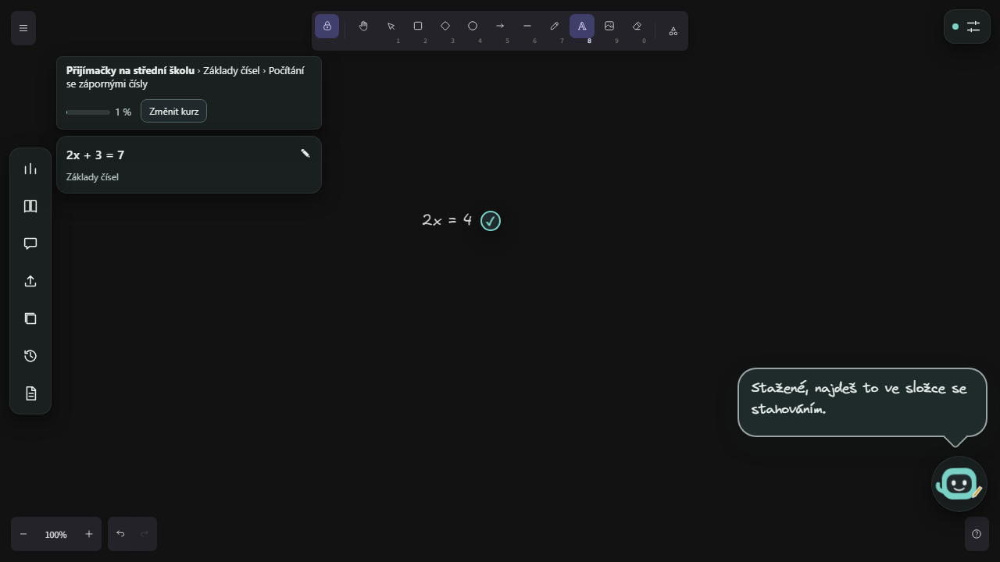
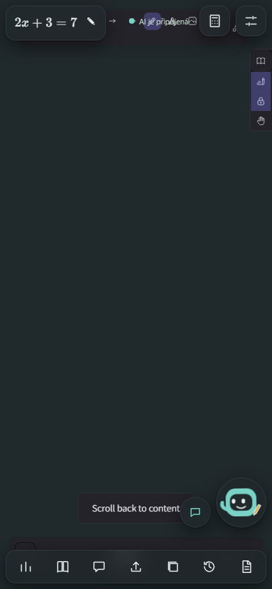
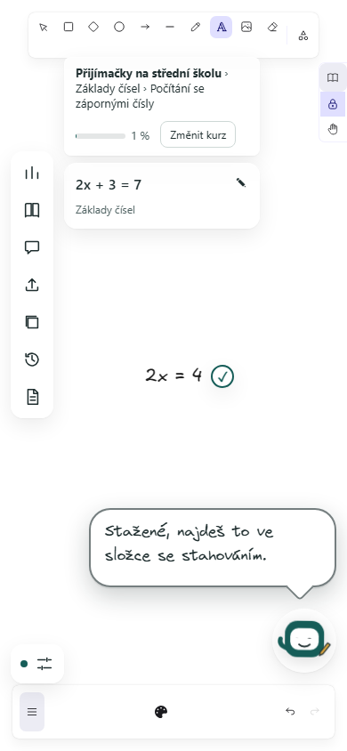
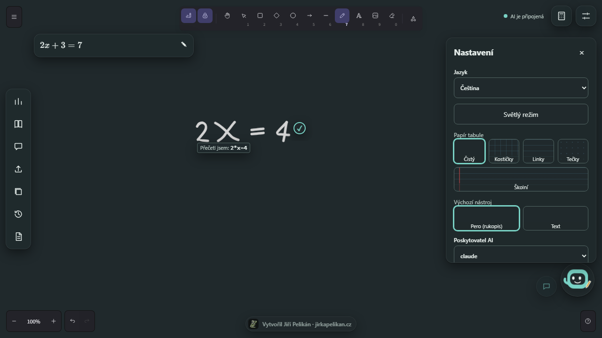

---

## Installation and setup

### Prerequisites
- **Node.js** version `>= 22.14.0`
- **npm** (included with Node.js)
- **Python** version `>= 3.10` (for the SymPy verification service)

### 1. Clone repository and install dependencies
```bash
git clone https://github.com/Esperosa/open-math-tutor.git
cd open-math-tutor
npm install
```

### 2. Prepare the Python verifier
The verifier runs in its own virtual environment in `verifier/`:
```bash
cd verifier
python -m venv .venv

# Windows:
.venv\Scripts\pip install -r requirements.txt
.venv\Scripts\python -m uvicorn app:app --port 4179

# macOS and Linux:
.venv/bin/pip install -r requirements.txt
.venv/bin/python -m uvicorn app:app --port 4179
```

### 3. Start the application
In the repository root, start the bridge and frontend in separate terminals:
```bash
# Terminal 1: local bridge (AI provider adapters and verifier proxy)
npm run dev:bridge

# Terminal 2: frontend UI
npm run dev:frontend
```

Open `http://localhost:5173` in your web browser.

### Running tests
```bash
npm run lint           # code style and linting
npm run typecheck      # TypeScript typechecking
npm run test:unit      # unit test suites across all packages
npm run test:verifier  # Python verifier tests (pytest)
npm run test:e2e       # end-to-end browser tests (Playwright)
```

---

## AI Connection (Bring your own subscription)

OpenMathTutor never sells subscriptions or relays third-party API keys. It interfaces with tools you already legally own on your machine:

### 1. Anthropic Claude
Install the official Anthropic Claude Code CLI and authenticate outside the app:
```bash
claude auth login
```
The app spawns `claude -p` in non-interactive mode with `--bare --tools ""` (no access to coding tools, file system, or MCP servers). It never reads, stores, or relays your credentials.

### 2. Google Gemini
To connect Google Gemini (such as free-tier access from Google AI Studio or Vertex AI), set your key using the helper script:
```bash
npm run set-gemini-key -w packages/bridge
```
Your key is stored locally in your user profile under `provider-keys.json`. Alternatively, export `GEMINI_API_KEY` or `GOOGLE_API_KEY`.
*Why not sign in with a Google account:* The app does not implement Google OAuth account flows, never stores OAuth session tokens, and only sends prompts to the official Google Generative Language REST endpoints. See [ARCHITECTURE.md](ARCHITECTURE.md) for details.

### 3. OpenAI Codex
The Codex CLI authenticates via `codex login`.
*Safety notice:* In the current Codex app-server protocol, no documented option exists to completely disallow system tool invocation per turn. To avoid pretending tools are safe when they are not, tutoring via Codex is deliberately disabled (`provider_unavailable`). Once OpenAI documents a strict tool-suppression mode, support will be enabled.

---

## Courses and curriculum

The application includes 10 courses covering 71 discrete skills:
- **High school entrance exams:** fractions, ratios, percentages, linear equations, word problems (modeled on public Cermat specifications).
- **Maturita / School leaving math:** algebraic expressions, functions, equations and inequalities, sequences.
- **University entrance exams:** analytic geometry, trigonometry, complex numbers.
- **University mathematics:** Algebra Foundations, Mathematical Analysis (limits, derivatives, integrals), Linear Algebra (matrices, determinants, vector spaces), Discrete Mathematics, Probability and Statistics.
- **Physics:** kinematics, dynamics, work and power, mechanical energy, density and pressure.
- **Chemistry:** molar concentration, molar mass, formula calculations, solution mixing.

### Custom course from your own notes (NotebookLM style)
In the courses drawer, upload your own `.txt` notes or `.pdf` textbook chapters. Text is parsed locally in the browser with pdf.js. OpenMathTutor runs a local TF-IDF search index without third-party embeddings or API calls. When you ask a question, the AI draws context directly from your uploaded materials.

---

## On-device handwriting recognition

You can write naturally by hand. The lightweight neural model runs entirely in browser JavaScript:

- **Measured accuracy benchmarks (from [ACCURACY.md](tools/handwriting/ACCURACY.md)):**
  - Official held-out MNIST test split (10,000 digits): **98.99%**
  - UCI `pendigits` database (14 unseen writers): **97.57%**
  - Unseen Hershey font families (triplex and complex): **92.08%**
  - Printed mathematical rows: **100%** (270 / 270)
  - Rows with unseen digit bodies: **91.00%** (182 / 200)
  - Line inference latency (15 symbols): median **20.1 ms**, p95 **24.8 ms** (well below the 50 ms budget).
  - Model footprint: ~900 KB (approx. 169,000 float32 parameters).

- **Known confusions and open gaps:**
  - The variable `x` and multiplication symbol `×` occasionally cross (38 cases in benchmark tests).
  - Rapid synthetic slashes `/` can read as the digit `1`.
  - In uncommon foreign font shapes, `4` may be read as `7` or `8` as `2`.
  - Specific decimal dot placements can read as center dots (both decimal commas and standard periods work reliably).

- **How to correct a misread:**
  Each recognized line displays a "Read as:" preview beside it. If a symbol was misread, click on the uncertain character to open candidate choices. Clicking the correct symbol fixes the line immediately and re-verifies the step.

---

## The AI teacher on the board (board actions)

The AI tutor uses the structured `board_actions` protocol:
- **Independent layer:** teacher annotations are rendered in a separate layer that never modifies your strokes and can be toggled or cleared at will.
- **Relative anchors (no absolute coordinates):** the model does not guess pixel coordinates; it references steps and symbols (`placement: relativeToStepId`, `side: below | right | over`).
- **Annotation actions:** circling mistakes, strike-through, highlighting, arrows, handwriting explanation labels, and worked next steps using a safe LaTeX subset (`\frac`, `\cdot`, `\times`, etc.).
- **Visual styling:** red ink for mistakes, teal ink for helpful hints, and handwritten typography.

---

## Tutor chat

- **Contextual buttons:** quick replies adapt to your current step ("Explain differently", "Show the next step", "Got it", "I do not get it", "Example").
- **Voice input:** push-to-talk microphone button powered by the browser Web Speech API.
- **Typed messages:** expandable message input for custom math inquiries.
- **Local FAQ:** common questions about app features and controls are answered on-device without reaching out to AI.

---

## Plan and progress

- **Mastery engine:** monitors concept retention across skills and adapts upcoming problems.
- **Honest accounting:** your first final answer per problem registers for mastery. Subsequent corrections after receiving guidance are praised without falsely recording an unassisted win.
- **Rounding:** course percentages are rounded to integers, accurately representing comprehensive topic completion.

---

## Take-home tests and notes

- **Printable tests:** generate a practice sheet with one click. The resulting `test.html` opens in your browser formatted for clean A4 printing or saving as a PDF. Solutions and the answer key are automatically formatted on a final standalone page.
- **Study notes:** export problem statements and solutions to Markdown (`.md`).
- **Visual exports:** save whiteboard snapshots as PNG or SVG images.

---

## Settings and customization

- **Paper background:** clean white, square grid, lined notebook, dot grid, and school margin paper.
- **Theme:** full dark and light mode.
- **Voice engine:**
  - Standard system synthesis voices (`speechSynthesis`).
  - High-quality offline Piper neural voices (`cs_CZ-jirka` and English voices) downloaded directly to your browser (OPFS, ~60 MB). Operates locally in a Web Worker using the Web Audio API with zero cloud speech transmission. Lessac research terms are detailed in [NOTICE.md](NOTICE.md).

---

## Privacy and security

1. **Everything stays on your machine:** frontend, bridge adapter, and Python verifier run locally.
2. **Zero tracking:** no analytics, tracking cookies, or remote databases.
3. **What is sent to AI:** when requesting assistance, only problem text, transcribed mathematical steps, local handwriting hints, and recent chat context are passed to the chosen model. Credentials, system files, and local tokens are never transmitted.
4. **Safe math execution:** the Python verifier strictly avoids `eval`, `exec`, `sympify`, or `parse_expr` on student or model text. Input passes through a constrained grammar parser into a tagged AST.

---

## Troubleshooting

- **AI status shows "offline":**
  Ensure the local bridge process is running (`npm run dev:bridge` on port 4178). For Claude, verify CLI authentication with `claude auth login`. For Gemini, ensure your key was configured via `npm run set-gemini-key -w packages/bridge`.
- **Bridge unreachable:**
  Check `http://127.0.0.1:4178/health` in your browser. It should report `{"status":"ok","verifier":"ok"}`.
- **localhost vs 127.0.0.1:**
  Always open the frontend at `http://localhost:5173`. For security (CSRF defense), the bridge explicitly allows `http://localhost:5173` and blocks `http://127.0.0.1:5173`.

---

## Known limitations (honest status)

- **Codex tutoring:** fail-closed (`provider_unavailable`) until OpenAI provides a supported flag to completely disallow shell tools per turn in the app-server protocol.
- **Claude multimodal input:** non-interactive Claude CLI does not accept raw image inputs (`multimodal_unsupported`). Handwriting is represented via structured on-device recognition hints.
- **Verifier scope:** SymPy step-by-step verification covers arithmetic, fractions, percentages, parentheses, and linear equations. Quadratic equations, geometry, and university subjects feature programmatically verified problem answers without multi-step intermediate proofs.
- **Word-by-word streaming:** tutor responses render upon receipt of validated JSON containing board actions rather than via incremental word-by-word token streams.
- **Native mobile builds:** native mobile wrappers (iOS/Android) are deferred; the web app is responsive across mobile touch browsers.

---

## Documentation links

- [ARCHITECTURE.md](ARCHITECTURE.md) – system architecture, trust boundaries, and adapters
- [BRIDGE_API.md](BRIDGE_API.md) – local bridge HTTP specification and `board_actions` protocol
- [NOTICE.md](NOTICE.md) – licenses of third-party libraries, datasets, and voice models
- [ai-disclosure.md](ai-disclosure.md) – transparent disclosure of AI tool usage during development
- [docs/handwriting-e2e-report.md](docs/handwriting-e2e-report.md) – empirical handwriting benchmarks and e2e test matrix
- [tools/handwriting/ACCURACY.md](tools/handwriting/ACCURACY.md) – comprehensive model accuracy reports
- [docs/media/README.md](docs/media/README.md) – media catalog and recording reproduction scripts

---

## Rights and license

**Author:** Jiří Pelikán, <https://jirkapelikan.cz>. Copyright © 2026 Jiří Pelikán. All rights not expressly granted by the license are reserved.

**License for code and text:** [PolyForm Noncommercial License 1.0.0](LICENSE). In plain words (only the license text is binding):

- **You may:** use, study, copy and modify the project for **non-commercial** purposes: personal learning, teaching, research, hobby work, schools, non-profits and public institutions.
- **You may not:** use the project or parts of it **commercially**: sell it, offer it as a paid service, build it into a paid product, use it in a for-profit business or otherwise monetize it.
- **You must:** when redistributing, pass on the license text and the `Required Notice` lines (author name Jiří Pelikán and the link <https://jirkapelikan.cz>). The attribution may not be removed or passed off as your own.
- **Changes and derivative works** are allowed only under the same terms and without commercial use.
- **Commercial license** on request: contact via <https://jirkapelikan.cz>.
- The software is provided "as is", without warranty. The author is not liable for teaching errors or AI output (see the unverified-answer notices in the app).

**Important:** earlier versions of this repository were published under the MIT license. Anyone who lawfully obtained those specific versions may keep them under MIT. From this commit on, all new versions are under PolyForm Noncommercial. The license is no longer "open source" in the OSI sense; it is "source-available".

**Logo and name:** the pelican logo ([`docs/brand/pelikan-logo.png`](docs/brand/pelikan-logo.png)) and the name Jiří Pelikán are **not covered by the code license**. All rights reserved; use outside this repository requires the author's permission.

**Contributions:** by submitting a contribution (pull request) you agree it may be distributed under this license and that the project author may change the license or add a commercial license in the future.

**Third parties:** the components used (Excalidraw, SymPy, KaTeX, Electron, pdf.js, React, Vite) keep their own licenses, listed in [NOTICE.md](NOTICE.md) and [ARCHITECTURE.md](ARCHITECTURE.md). The `codex` and `claude` tools are installed by the user and governed by their providers' terms. "Claude", "Claude Code", "Codex" and "OpenAI" are trademarks of their owners; the project is not affiliated with them.

**Offline voices:** the Piper voices are downloaded on request from Hugging Face and stored only in the browser; they are not part of the repository or the installation. All four are finetuned from the Lessac research voice, whose license terms (non-commercial, manual verification) are spelled out in [NOTICE.md](NOTICE.md).

**AI use disclosure:** part of the code was written with AI tools (OpenAI Codex, Anthropic Claude) and reviewed and tested; see [ai-disclosure.md](ai-disclosure.md). The logo, the author texts and the licensing provisions are the author's own human work.

This overview is not legal advice.
