<p align="center"><a href="https://jirkapelikan.cz">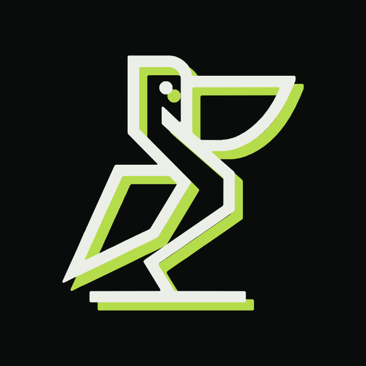</a></p>

# OpenMathTutor

*English version: [README.en.md](README.en.md)*

> Vytvořil a autorsky vlastní **[Jiří Pelikán](https://jirkapelikan.cz)**. Zdrojově dostupný projekt pro **nekomerční** užití ([PolyForm Noncommercial 1.0.0](LICENSE)); při sdílení nebo úpravě musí zůstat uvedeno autorství. Podrobnosti v sekci [Práva a licence](#práva-a-licence).

OpenMathTutor je interaktivní tabule, která v reálném čase čte tvůj rukopis a učí tě jako trpělivý osobní učitel matematiky, fyziky a chemie.

---

## Jak to funguje v 60 sekundách

1. **Vybereš si kurz:** zvolíš si přípravu na přijímačky, maturitu, vysokoškolskou matematiku, fyziku, chemii, nebo nahraješ vlastní materiály.
2. **Píšeš přímo na tabuli:** prstem na dotykovém displeji, stylusem, myší nebo klávesnicí. Žádné přepínání nástrojů.
3. **Okamžitá lokální kontrola:** malý vestavěný neuronový model přečte rukopis přímo v prohlížeči (do ~20 ms). Matematický verifikátor ověří každý krok a zobrazí značku ✓ nebo ✗. Vše běží na tvém počítači bez odesílání dat do cloudu.
4. **Učitel reaguje přímo na ploše:** při chybě k ní animovaný maskot dojde a AI učitel ti přímo na tabuli zakroužkuje problematické místo, nakreslí šipku a rukopisným písmem dopíše radu či další krok.
5. **Můžeš se kdykoli zeptat:** klepnutím na rychlou odpověď, hlasem přes mikrofon nebo zprávou v chatu. Aplikace sleduje tvůj pokrok a umí připravit cvičný test k tisku do PDF.

---

## Tutoriál krok za krokem

Následující kroky tě provedou celou aplikací od prvního spuštění až po pokročilé funkce.

### 1. Výběr kurzu a první lekce

Při prvním spuštění tě přivítá úvodní rozcestník, kde si zvolíš zaměření a úroveň. Výběrem tématu se rovnou otevře čistá digitální tabule s první úlohou. Kdykoli se můžeš vrátit do katalogu kurzů přes boční panel.

<video src="docs/media/01-first-lesson.mp4" controls muted width="720"></video>
<p><em>Záznam: <a href="docs/media/01-first-lesson.mp4">docs/media/01-first-lesson.mp4</a> – Výběr kurzu a otevření první lekce</em></p>

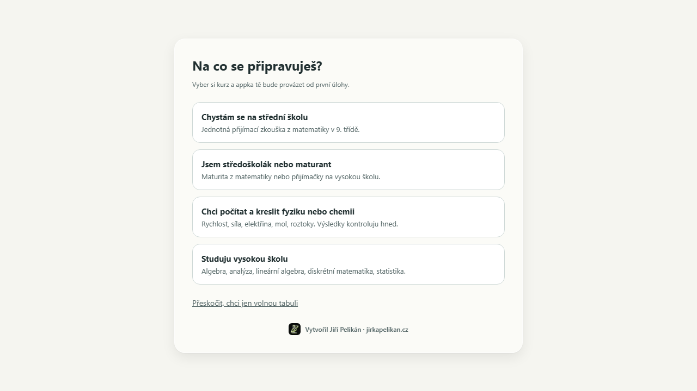
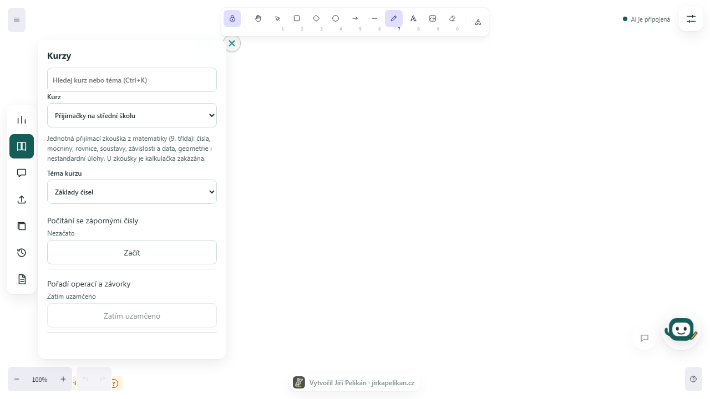
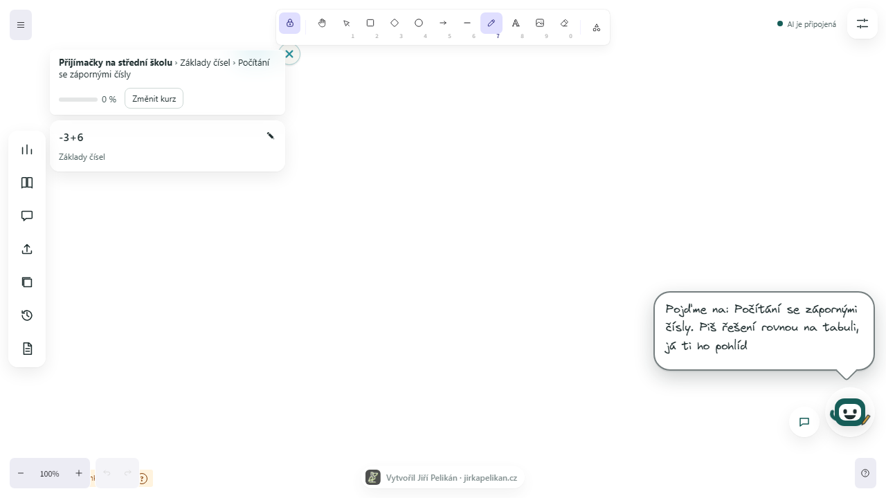


### 2. Psaní rukou a okamžitá kontrola

Klikni na tabuli a začni psát svůj postup. Tahy tužkou nebo perem aplikace automaticky seskupuje do řádků a symbolů. Do ~20 ms po dokončení řádku se zobrazí přepis a verdikt lokálního ověření.

Když uděláš chybu, řádek se označí červeným symbolem ✗. Animovaný maskot k chybě dojde a nabídne pomoc. Pokud model některé číslo přečetl nepřesně, klepni na bublinu „Přečetl jsem:“ a ze seznamu kandidátů zvol správný znak. Řádek se okamžitě přepočítá jedním klepnutím bez nutnosti brát do ruky klávesnici.

<video src="docs/media/02-handwriting-check.mp4" controls muted width="720"></video>
<p><em>Záznam: <a href="docs/media/02-handwriting-check.mp4">docs/media/02-handwriting-check.mp4</a> – Psaní rukou, odhalení chyby a oprava</em></p>

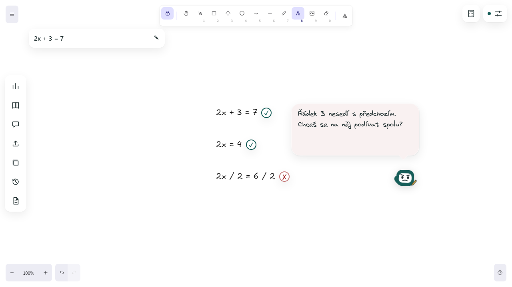
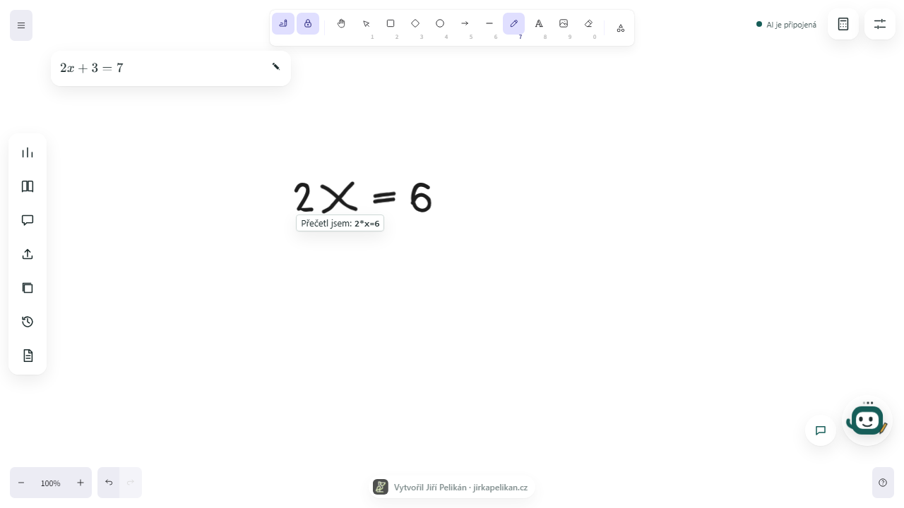

### 3. AI učitel píše na tabuli

AI doučovatel nevypisuje dlouhé odstavce do chatu. Píše jako skutečný učitel přímo do plochy tabule ve zvláštní vrstvě: zakroužkuje nebo škrtne chybný člen červeným perem, nakreslí tyrkysovou šipku a rukopisným fontem dopíše nápovědu nebo rozpracovaný další krok. Poznámky učitele můžeš kdykoli skrýt nebo smazat.

<video src="docs/media/03-ai-teacher-writes.mp4" controls muted width="720"></video>
<p><em>Záznam: <a href="docs/media/03-ai-teacher-writes.mp4">docs/media/03-ai-teacher-writes.mp4</a> – Zápis učitele přímo na tabuli</em></p>

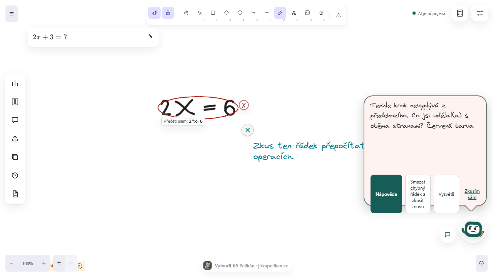

### 4. Rozhovor s tutorem

Vedle maskota najdeš tlačítko pro otevření rozhovoru. Můžeš reagovat bez psaní pomocí situačních tlačítek („Vysvětli jinak“, „Ukaž další krok“, „Chápu“, „Nechápu“, „Příklad“), mluvit hlasem přes mikrofon nebo napsat vlastní dotaz. Otázky na ovládání aplikace (jak funguje kontrola, co znamená ✓/✗, jak smazat řádek) zodpoví aplikace okamžitě lokálně i bez připojené AI.

<video src="docs/media/04-chat.mp4" controls muted width="720"></video>
<p><em>Záznam: <a href="docs/media/04-chat.mp4">docs/media/04-chat.mp4</a> – Rozhovor s tutorem a rychlé odpovědi</em></p>

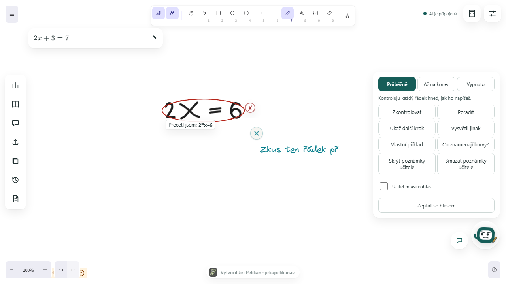
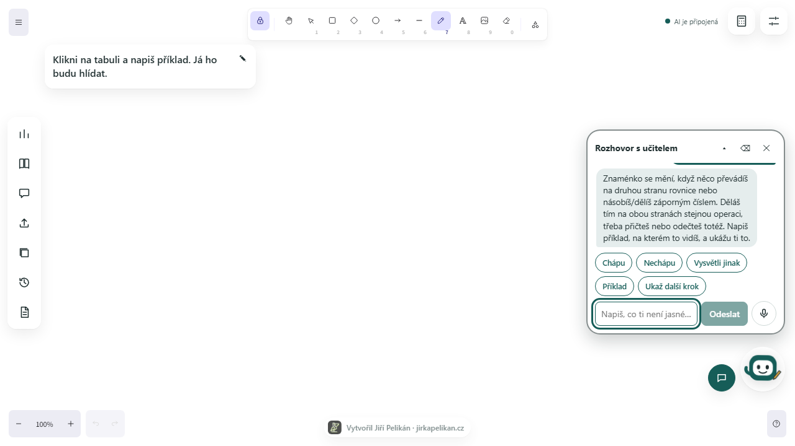

### 5. Plán a sledování pokroku

V levé zásuvce „Plán a cesta“ vidíš přehled zvládnutých dovedností a celková procenta kurzu. Systém adaptivní obtížnosti vybírá další příklady podle toho, které typy úloh ti dělají potíže. Do celkového skóre se započítává první samostatné vyřešení úlohy; pozdější oprava tě pochválí a posune dál.

<video src="docs/media/05-plan-progress.mp4" controls muted width="720"></video>
<p><em>Záznam: <a href="docs/media/05-plan-progress.mp4">docs/media/05-plan-progress.mp4</a> – Průchod plánem a růst procent</em></p>

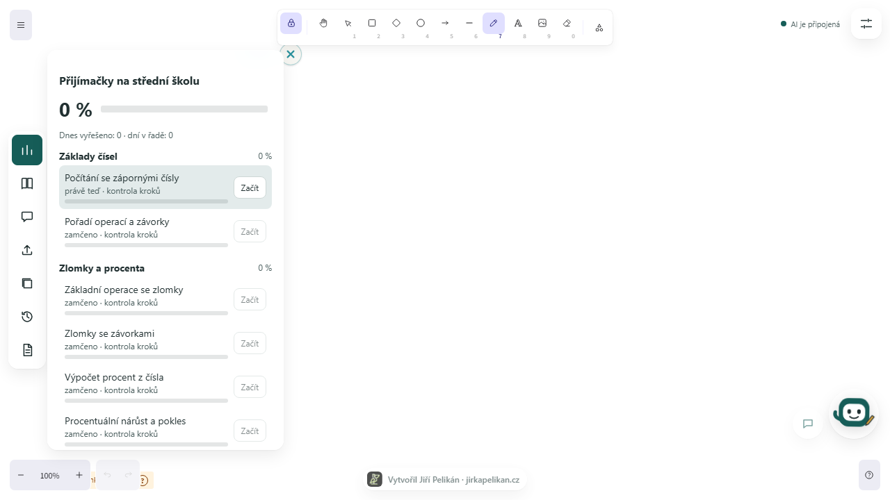


### 6. Fyzika, chemie a výpočty s jednotkami

Aplikace neprověřuje jen čistou matematiku. V kurzech fyziky a chemie zapisuješ veličiny včetně fyzikálních jednotek (např. m/s, km/h, g/cm³, mol/l). Lokální verifikátor podporuje jednotkové aliasy, desetinnou čárku i tečku a kontroluje přesnost bez plošných tolerancí.

<video src="docs/media/06-physics-units.mp4" controls muted width="720"></video>
<p><em>Záznam: <a href="docs/media/06-physics-units.mp4">docs/media/06-physics-units.mp4</a> – Řešení fyzikálního příkladu s jednotkami</em></p>

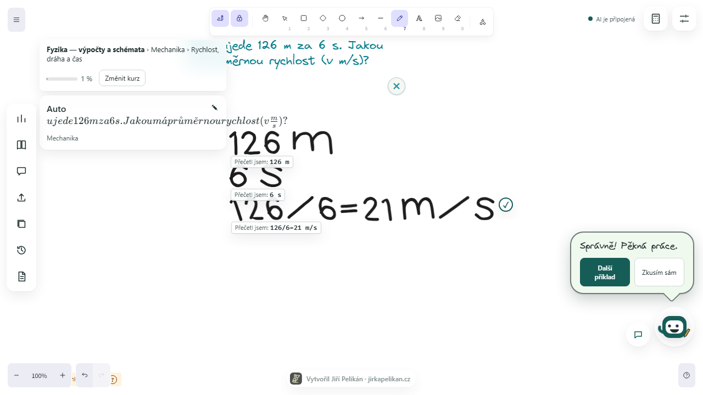


### 7. Test na doma a export zápisků

Potřebuješ si vyzkoušet své znalosti na papíře? V aplikaci si můžeš jedním kliknutím vygenerovat cvičný test ve formátu HTML, který v prohlížeči vytiskneš přímo do PDF. Klíč se správnými odpověďmi a postupy je umístěn na samostatné stránce na konci. Zápisky z tabule lze exportovat do Markdownu (`.md`) a samotnou tabuli uložit jako PNG nebo SVG.

<video src="docs/media/07-test-and-export.mp4" controls muted width="720"></video>
<p><em>Záznam: <a href="docs/media/07-test-and-export.mp4">docs/media/07-test-and-export.mp4</a> – Generování testu a export zápisků</em></p>

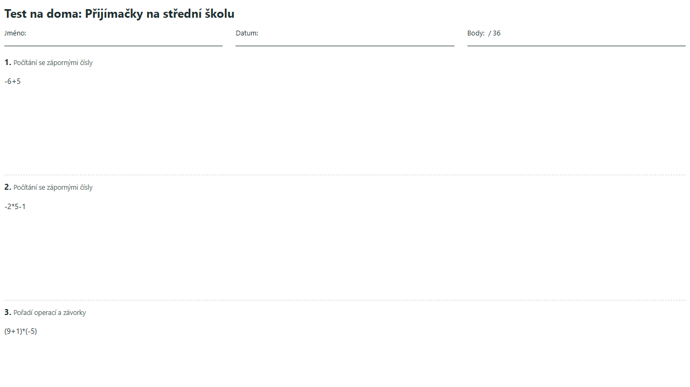

### 8. Nastavení, papír tabule a offline hlasy

Vysouvací panel Nastavení ti umožní přizpůsobit prostředí podle svých potřeb:
- **Vzory papíru:** čistý bílý, čtverečkovaný, linkovaný, tečkovaný a školní se svislým okrajem. Vzory reagují na zoom a posun plátna.
- **Vzhled:** světlý a tmavý režim tabule i ovládacích panelů.
- **Hlasový výstup:** vedle systémových hlasů můžeš zvolit vysoce kvalitní offline hlasy Piper (`cs_CZ-jirka`, anglické modely), které běží přímo v prohlížeči přes WebAssembly. Model se stáhne jednou (~60 MB) do lokálního úložiště prohlížeče a funguje i bez připojení k internetu.

<video src="docs/media/08-settings-paper-voices.mp4" controls muted width="720"></video>
<p><em>Záznam: <a href="docs/media/08-settings-paper-voices.mp4">docs/media/08-settings-paper-voices.mp4</a> – Přepínání vzorů papíru a volba hlasů</em></p>

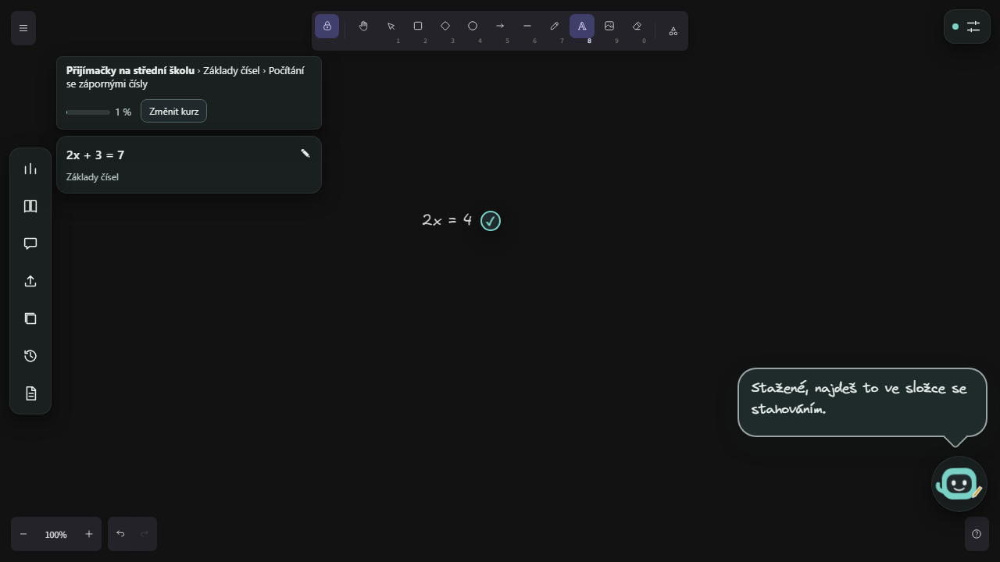
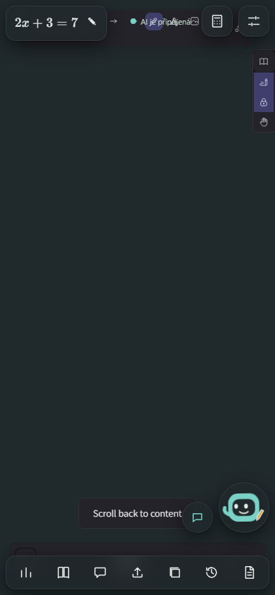
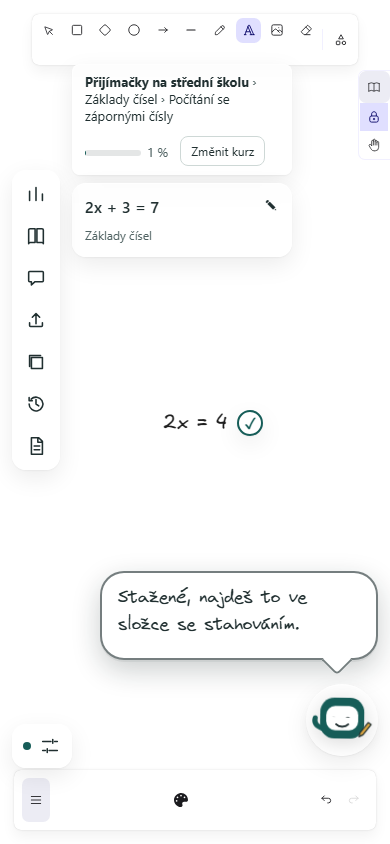
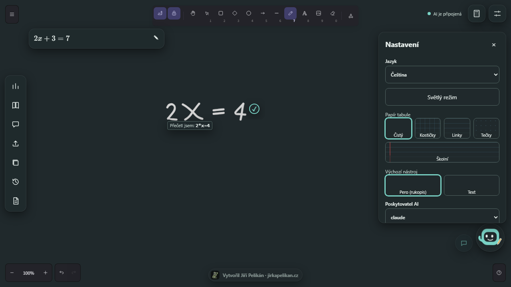

---

## Instalace a spuštění

### Požadavky na systém
- **Node.js** verze `>= 22.14.0`
- **npm** (součást Node.js)
- **Python** verze `>= 3.10` (pro matematický verifikátor SymPy)

### 1. Klonování a instalace balíčků
```bash
git clone https://github.com/Esperosa/open-math-tutor.git
cd open-math-tutor
npm install
```

### 2. Příprava Python verifikátoru
Verifikátor běží v samostatném virtuálním prostředí v adresáři `verifier`:
```bash
cd verifier
python -m venv .venv

# Windows:
.venv\Scripts\pip install -r requirements.txt
.venv\Scripts\python -m uvicorn app:app --port 4179

# macOS a Linux:
.venv/bin/pip install -r requirements.txt
.venv/bin/python -m uvicorn app:app --port 4179
```

### 3. Spuštění aplikace
V kořenovém adresáři projektu spusť v samostatných terminálech bridge a frontend:
```bash
# Terminál 1: lokální bridge (poskytovatelé AI a spojení s verifikátorem)
npm run dev:bridge

# Terminál 2: uživatelské rozhraní
npm run dev:frontend
```

Frontend se otevře v prohlížeči na adrese `http://localhost:5173`.

### Spuštění testů
```bash
npm run lint           # statická kontrola kódu
npm run typecheck      # kontrola TypeScript typů
npm run test:unit      # jednotkové testy všech balíčků
npm run test:verifier  # testy matematického verifikátoru (pytest)
npm run test:e2e       # integrační end-to-end testy (Playwright)
```

---

## Připojení AI (Bring your own subscription)

OpenMathTutor neprodává žádné předplatné ani nepřeposílá cizí klíče. Využívá nástroje, které už sám legálně vlastníš a provozuješ na svém počítači:

### 1. Anthropic Claude
Nainstaluj oficiální Anthropic Claude Code CLI a přihlas se mimo aplikaci:
```bash
claude auth login
```
Aplikace spouští `claude -p` v neinteraktivním režimu s bezpečnostním omezením `--bare --tools ""` (bez přístupu ke kódu, souborům a MCP). Nečte ani neukládá tvé přihlašovací údaje.

### 2. Google Gemini
Pokud preferuješ Google Gemini (např. bezplatnou kvótu z Google AI Studio nebo Vertex AI), zadej svůj API klíč pomocí skriptu:
```bash
npm run set-gemini-key -w packages/bridge
```
Klíč se uloží do tvého lokálního uživatelského profilu do souboru `provider-keys.json`. Alternativně můžeš nastavit proměnnou prostředí `GEMINI_API_KEY` nebo `GOOGLE_API_KEY`.
*Proč ne přihlášení Google účtem:* Aplikace nevytváří vlastní OAuth bránu pro účty Google, neukládá uživatelské přihlašovací tokeny a klíč komunikuje výhradně s oficiálním REST rozhraním Google Generative Language. Podrobnosti viz [ARCHITECTURE.md](ARCHITECTURE.md).

### 3. OpenAI Codex
Codex CLI se přihlašuje příkazem `codex login`.
*Upozornění k bezpečnosti:* V aktuální verzi Codex app-server protokolu neexistuje zdokumentovaný mechanismus, kterým by šlo modelu zcela odepřít spouštění systémových nástrojů. Abychom nepředstírali zabezpečení, je doučování přes Codex záměrně vypnuté (`provider_unavailable`). Jakmile OpenAI umožní spolehlivě odepřít nástroje, podpora bude aktivována.

---

## Kurzy a výukový obsah

Aplikace obsahuje 10 kompletních kurzů s celkem 71 dovednostmi:
- **Přijímací zkoušky na SŠ:** zlomky, poměry, procenta, lineární rovnice, slovní úlohy (podle veřejných specifikací Cermat).
- **Maturita z matematiky:** algebraické výrazy, funkce, rovnice a nerovnice, posloupnosti.
- **Přijímací zkoušky na VŠ:** analytická geometrie, goniometrie, komplexní čísla.
- **Vysokoškolská matematika:** Základy algebry, Matematická analýza (limity, derivace, integrály), Lineární algebra (matice, determinanty, vektorové prostory), Diskrétní matematika, Pravděpodobnost a statistika.
- **Fyzika:** kinematika, dynamika, práce a výkon, mechanická energie, hustota a tlak.
- **Chemie:** látková koncentrace, molární hmotnost, výpočty ze vzorců, směšování roztoků.

### Vlastní kurz z vlastních materiálů (NotebookLM styl)
V sekci kurzů můžeš nahrát vlastní textové materiály (`.txt`) nebo skripta v PDF (`.pdf`). Text se extrahuje lokálně v prohlížeči pomocí knihovny pdf.js. Aplikace provádí vyhledávání pomocí lokálního TF-IDF indexu bez posílání souborů na externí servery a bez placených embeddingů. Při dotazu AI doučovatel vychází přímo z tvých materiálů.

---

## Rozpoznávání rukopisu na tabuli

Můžeš psát přirozeně rukou. Lokální model běží přímo v JavaScriptu ve tvém prohlížeči:

- **Poctivě naměřená přesnost (z [ACCURACY.md](tools/handwriting/ACCURACY.md)):**
  - Oficiální held-out testovací sada MNIST (10 000 číslic): **98,99 %**
  - Databáze UCI `pendigits` (14 neviděných pisatelů): **97,57 %**
  - Neviděné rodiny Hershey fontů (triplex a complex): **92,08 %**
  - Tištěné matematické řádky: **100 %** (270 z 270)
  - Řádky s neviděnými tvary číslic: **91,00 %** (182 z 200)
  - Rychlost vyhodnocení jednoho řádku (15 symbolů): medián **20,1 ms**, p95 **24,8 ms** (vše hluboko pod limitem 50 ms).
  - Velikost modelu: ~900 kB (169 000 parametrů float32).

- **Známé záměny a otevřené mezery:**
  - Znak `x` jako proměnná a symbol násobení `×` se občas zamění (v testech 38 případů).
  - V některých rychlých syntetických tazích se lomítko `/` může přečíst jako číslice `1`.
  - V neobvyklých cizích fontech se může číslice `4` zaměnit za `7` nebo `8` za `2`.
  - Specifická poloha desetinné tečky může být někdy přečtena jako středová tečka násobení (desetinná čárka i standardní tečka fungují spolehlivě).

- **Co dělat při chybném čtení:**
  Vedle řádku se vždy zobrazí náhled rozpoznaného textu. Pokud došlo k chybě, klepni na nejistý symbol – rozbalí se nabídka kandidátů. Kliknutím na správný znak se řádek okamžitě opraví a verifikátor jej znovu přepočítá.

---

## Učitel na tabuli (jak AI reaguje)

AI doučovatel komunikuje prostřednictvím strukturovaného protokolu `board_actions`:
- **Oddělená vrstva:** poznámky doučovatele se kreslí do samostatné vrstvy, která nepřepisuje tvůj text a lze ji kdykoli skrýt nebo vymazat.
- **Relativní kotvy (žádné absolutní souřadnice):** AI neurčuje pixely na obrazovce; odkazuje se na konkrétní řádky a symboly (`placement: relativeToStepId`, `side: below | right | over`).
- **Nástroje oprav:** kroužek kolem chyby, přeškrtnutí, zvýraznění, šipka, rukopisné textové vysvětlení a vzorec dalšího kroku v bezpečném subsetu LaTeXu (`\frac`, `\cdot`, `\times` apod.).
- **Vizuální odlišení:** červené pero pro označení chybného místa, tyrkysové pero pro vysvětlující nápovědu a font imitující rukopis.

---

## Rozhovor s tutorem (Chat)

- **Situační tlačítka:** podle stavu tabule máš k dispozici rychlé reakce („Vysvětli jinak“, „Ukaž další krok“, „Chápu“, „Nechápu“, „Příklad“).
- **Hlasový vstup:** tlačítko mikrofonu využívá nativní Web Speech API prohlížeče.
- **Psaná zpráva:** možnost rozbalit textové pole a napsat vlastní doplňující otázku.
- **Lokální FAQ:** běžné otázky k ovládání aplikace zodpoví vestavěný modul okamžitě bez připojení k AI.

---

## Plán a procenta

- **Mastery systém:** aplikace sleduje tvou úspěšnost v jednotlivých dovednostech a adaptivně upravuje úroveň dalších úloh.
- **Férové hodnocení:** do postupu se započítává první finální pokus o vyřešení úlohy. Pokud příklad napoprvé nevyjde a opravíš ho až po nápovědě, získáš pochvalu, ale do statistiky se nezapíše falešný stoprocentní úspěch.
- **Zaokrouhlování:** celková procenta kurzu jsou zaokrouhlená na celá čísla a odrážejí reálné zvládnutí látky.

---

## Testy na doma a zápisky

- **Cvičný test k tisku:** v sekci exportu klikni na vygenerování testu. Stáhne se soubor `test.html`, který se otevře v prohlížeči a je formátován pro čistý tisk na A4 nebo uložení do PDF. Klíč se správným řešením je automaticky umístěn na samostatné stránce na konci dokumentu.
- **Studijní zápisky:** export řešených úloh do formátu Markdown (`.md`).
- **Grafický export tabule:** uložení aktuální plochy jako obrázek PNG nebo vektorové SVG.

---

## Nastavení a přizpůsobení

- **Podklad tabule:** čistá bílá, čtverečkovaný papír, linkovaný papír, tečkovaná mřížka, školní sešit se svislým okrajem.
- **Motiv:** plnohodnotný světlý i tmavý režim pro šetření zraku.
- **Hlasový syntetizér:**
  - Hlasy operačního systému v prohlížeči (`speechSynthesis`).
  - Offline hlasy Piper: kvalitní neuronové hlasy (`cs_CZ-jirka` a anglické modely) stažené přímo do prohlížeče (OPFS, ~60 MB). Běží lokálně ve Web Workeru s využitím Web Audio API bez jakéhokoli odesílání hlasu do cloudu. Podmínky výzkumné licence Lessac jsou uvedeny v [NOTICE.md](NOTICE.md).

---

## Soukromí a bezpečnost

1. **Vše běží u tebe:** uživatelské rozhraní, komunikační bridge i Python verifikátor běží lokálně na tvém počítači.
2. **Žádné sledování ani účty:** aplikace nepoužívá sledovací cookies, analytické nástroje ani centrální uživatelskou databázi.
3. **Co se posílá do AI:** při vyžádání rady se poskytovateli odešle zadání příkladu, textový přepis tvých matematických kroků, lokální hinty z rozpoznávání rukopisu a krátký kontext rozhovoru. Nikdy se neposílají hesla, systémové soubory ani privátní klíče.
4. **Matematické bezpečí:** Python verifikátor nepoužívá `eval`, `exec`, `sympify` ani `parse_expr` na neprověřeném textu. Všechna data procházejí striktním jednoúčelovým parserem do AST stromu.

---

## Řešení potíží

- **AI hlásí stav „offline“:**
  Ujisti se, že ti v terminálu běží bridge (`npm run dev:bridge` na portu 4178). Pokud používáš Claude, ověř přihlášení příkazem `claude auth login`. Pokud používáš Gemini, zkontroluj zadání klíče příkazem `npm run set-gemini-key -w packages/bridge`.
- **Bridge je nedostupný nebo neodpovídá:**
  Ověř ve webovém prohlížeči stav na adrese `http://127.0.0.1:4178/health`. Měl by vrátit stav `{"status":"ok","verifier":"ok"}`.
- **Rozdíl mezi localhost a 127.0.0.1:**
  Frontend otevírej vždy jako `http://localhost:5173`. Bridge z bezpečnostních důvodů (ochrana proti CSRF) výslovně povoluje původ `http://localhost:5173`, zatímco `http://127.0.0.1:5173` odmítá.

---

## Omezení projektu (otevřeně a poctivě)

- **Codex tutoring:** je dočasně uzamčen (`provider_unavailable`), dokud OpenAI v CLI rozhraní neumožní spolehlivě zamezit modelu v přístupu k systémovým nástrojům.
- **Obrázky v Claude:** neinteraktivní režim Claude CLI nepodporuje přímé předávání obrázků (`multimodal_unsupported`). Rukopis je proto předáván formou lokálně přečtených strukturovaných symbolů.
- **Rozsah krokového verifikátoru:** automatická kontrola krok za krokem pomocí SymPy pokrývá aritmetiku, zlomky, procenta, závorky a lineární rovnice. Kvadratické rovnice, geometrie a vysokoškolská matematika mají v katalogu připravené úlohy s programovou kontrolou výsledků, ale bez krokové verifikace mezikroků.
- **Streamování textu:** odpovědi AI doučovatele se zobrazují po dokončení celého požadavku, nikoli slovo po slově (poskytovatelé vracejí strukturovaný JSON s akcemi na tabuli najednou).
- **Mobilní nativní balíček:** mobilní aplikace pro Android a iOS zatím nejsou sestaveny; webové rozhraní je však plně responzivní pro mobilní prohlížeče.

---

## Odkazy na dokumentaci

- [ARCHITECTURE.md](ARCHITECTURE.md) – systémová architektura, bezpečnostní hranice a adaptéry
- [BRIDGE_API.md](BRIDGE_API.md) – specifikace HTTP rozhraní lokálního bridge a protokolu `board_actions`
- [NOTICE.md](NOTICE.md) – licence použitých knihoven, modelů a komponent třetích stran
- [ai-disclosure.md](ai-disclosure.md) – transparentní evidence použití AI nástrojů při vývoji
- [docs/handwriting-e2e-report.md](docs/handwriting-e2e-report.md) – naměřené výsledky a testovací matice rukopisu
- [tools/handwriting/ACCURACY.md](tools/handwriting/ACCURACY.md) – podrobné metriky přesnosti lokálního modelu
- [docs/media/README.md](docs/media/README.md) – katalog prezentačních médií a skripty pro jejich reprodukci

---

## Práva a licence

**Autor:** Jiří Pelikán, <https://jirkapelikan.cz>. Copyright © 2026 Jiří Pelikán. Všechna práva, která tato licence výslovně neuděluje, jsou vyhrazena.

**Licence kódu a textů:** [PolyForm Noncommercial License 1.0.0](LICENSE). Zjednodušeně (závazný je pouze text licence):

- **Smíte:** používat, studovat, kopírovat a upravovat projekt pro **nekomerční** účely: osobní učení, výuka, výzkum, hobby, školy, neziskové organizace a veřejné instituce.
- **Nesmíte:** použít projekt nebo jeho části **komerčně**: prodávat ho, nabízet jako placenou službu, zabudovat do placeného produktu, používat pro výdělečnou firmu nebo ho jinak monetizovat.
- **Musíte:** při dalším šíření předat text licence a řádky `Required Notice` (jméno autora Jiří Pelikán a odkaz na <https://jirkapelikan.cz>). Autorství nelze odstranit ani vydávat za vlastní.
- **Úpravy a odvozeniny** smějí vzniknout jen pod stejnými podmínkami a bez komerčního užití.
- **Komerční licence** na vyžádání: kontakt přes <https://jirkapelikan.cz>.
- Software je poskytován „tak, jak je“, bez záruky. Autor neodpovídá za chyby ve výuce ani za výsledky AI (viz upozornění o neověřených odpovědích v aplikaci).

**Důležité upřesnění:** dřívější verze tohoto repozitáře byly zveřejněny pod licencí MIT. Kdo je v té době legálně získal, smí si tyto konkrétní verze ponechat pod MIT. Od tohoto commitu platí pro všechny nové verze PolyForm Noncommercial. Licence už není „open source“ ve smyslu definice OSI, ale „zdrojově dostupná“.

**Logo a značka:** logo pelikána ([`docs/brand/pelikan-logo.png`](docs/brand/pelikan-logo.png)) a jméno Jiří Pelikán **nespadají pod licenci kódu**. Všechna práva vyhrazena; použití mimo tento repozitář vyžaduje svolení autora.

**Příspěvky:** zasláním příspěvku (pull request) souhlasíte, že je možné ho šířit pod touto licencí a že autor projektu smí licenci v budoucnu změnit nebo doplnit komerční licencí.

**Třetí strany:** použité komponenty (Excalidraw, SymPy, KaTeX, Electron, pdf.js, React, Vite) mají vlastní licence uvedené v [NOTICE.md](NOTICE.md) a [ARCHITECTURE.md](ARCHITECTURE.md); jejich podmínky platí dál. Nástroje `codex` a `claude` si uživatel instaluje sám a řídí se podmínkami jejich poskytovatelů. „Claude“, „Claude Code“, „Codex“ a „OpenAI“ jsou ochranné známky svých vlastníků; projekt s nimi není nijak spojen.

**Offline hlasy:** kvalitní hlasy Piper se stahují na přání uživatele z Hugging Face a ukládají se jen v prohlížeči – v repozitáři ani v instalaci nejsou. Všechny čtyři jsou dotrénované z výzkumného hlasu Lessac, jehož licenční podmínky (nekomerční, s ručním ověřením) jsou rozepsané v [NOTICE.md](NOTICE.md).

**Evidence použití AI:** část kódu vznikla s pomocí AI nástrojů (OpenAI Codex, Anthropic Claude) a prošla kontrolou a testy; podrobnosti v [ai-disclosure.md](ai-disclosure.md). Logo, texty o autorovi a licenční ustanovení jsou lidskou prací autora.

Tento přehled není právní poradenství.
